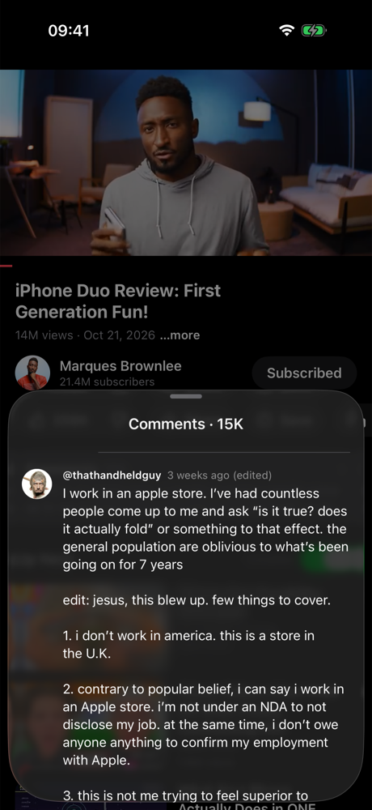
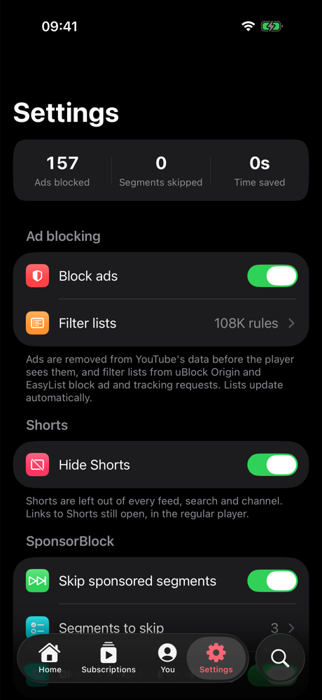
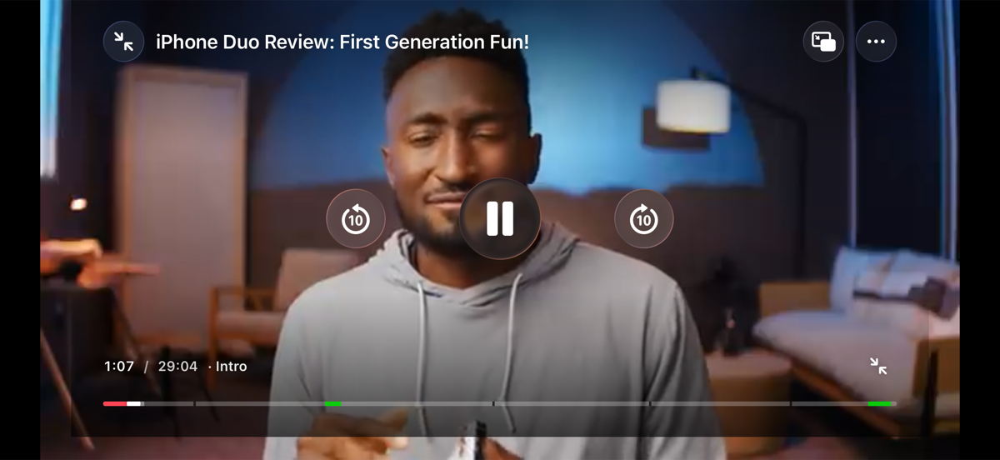

<div align="center">


# Unreel

**YouTube without ads, without Shorts, without sponsor reads — as a native iOS 26 app.**

   

   



</div>

Every screen in Unreel is SwiftUI: feeds, search, channels, playlists, comments and the player
controls. YouTube's data comes from its internal API (InnerTube), using the same cookies as your
sign-in. Videos play through YouTube's own web player in a hidden view that only shows the
picture, so streams keep working the way they do on youtube.com. Ads are removed from the
player's data before it reads them.

Unreel can't go on the App Store. Sideload it with a free Apple ID, for example with
[AirRefresh](https://github.com/nikolaus018/airRefresh).

## Contents

- [Features](#features)
- [Install](#install)
- [Using the app](#using-the-app)
- [How ad blocking works](#how-ad-blocking-works)
- [Privacy](#privacy)
- [Build from source](#build-from-source)
- [Project layout](#project-layout)
- [Known limitations](#known-limitations)
- [Credits](#credits)

## Features

**Without the noise**
- **No ads.** Video ads, banners and promoted results never appear. See [How ad blocking works](#how-ad-blocking-works).
- **No Shorts** in Home, Subscriptions, search or channel pages. Links to Shorts still open, in the regular player.
- **SponsorBlock** skips sponsor reads, self-promotion and "like and subscribe" reminders (you choose the categories). Segments are marked green on the scrubber, and an Undo notice appears after each skip.

**Player**
- Liquid Glass controls: play/pause, ±10 s, a scrubber that shows what's loaded, chapter marks and the current chapter's name.
- Double-tap the left or right side to seek. Repeated taps add up (10, 20, 30 s…).
- Press and hold for 2× speed.
- Speed, quality and captions menu.
- Rotation like the YouTube app: turn the phone to go fullscreen and back. The fullscreen button forces landscape while you hold the phone upright, swipe up on the video for fullscreen and swipe down to leave.
- Drag the video down to shrink it into the **mini player** above the tab bar (play/pause, next, close).
- **Autoplay** with an "Up next in 5" card (Cancel / Play Now). In the background or Picture in Picture it moves on right away.
- Background audio, lock-screen and Control Center controls with artwork, Picture in Picture.
- Videos that can't play (removed, private, blocked) show YouTube's reason instead of a spinner.

**Native screens**
- **Home:** your recommendations with watched-progress bars, plus Music, Gaming, Podcasts, News and Sports chips.
- **Subscriptions:** a row of your channels and the latest uploads.
- **You:** History, Watch Later, Liked videos, Playlists, Channels, and the ads-blocked stats.
- **Search:** native search field with suggestions and recent searches, plus All / Videos / Channels / Playlists / Live filters.
- **Watch page:** like/dislike, Subscribe, Save to Watch Later, Share, PiP; a description sheet with working links, tappable timestamps and a chapter list; comments with reply threads; Up Next.
- **Playlists:** Play All and Shuffle. Playing from a playlist builds a queue that Next and autoplay follow.
- **Channels:** banner, stats, Subscribe, and Videos / Live / Playlists tabs.
- **Long-press any video:** Play, Play Next, Go to Channel, Save to Watch Later, Share, Copy Link.

**Everything else**
- Google sign-in, with personal feeds and account actions.
- `youtube.com`, `youtu.be` and `unreel://` links open in the app, including `?t=` timestamps.
- Dark and light mode, haptics, a settings screen for all of the above.

## Install

1. Download `Unreel-1.0.0.ipa` from the [latest release](../../releases/latest).
2. Sign and install it with your sideloading tool (AirRefresh, Sideloadly, AltStore, …).
   There are no app extensions, so one free-account app ID is enough.
3. Open Unreel, then sign in from **You ▸ Sign In with Google** if you want your feeds.

Requires iOS 26.1 or later.

## Using the app

| Gesture | Where | Does |
| --- | --- | --- |
| Tap | Video | Show / hide controls |
| Double-tap left / right | Video | Seek −10 / +10 s (taps add up) |
| Press and hold | Video | Play at 2× while held |
| Swipe down | Video (portrait) | Shrink into the mini player |
| Swipe up | Video (portrait) | Full screen |
| Swipe down | Video (full screen) | Leave full screen |
| Turn the phone | Player open | Enter / leave full screen |
| Drag the scrubber | Controls | Seek, with a tick at each chapter |
| Long-press | Any video | Play Next, Watch Later, Share… |
| Long-press | Mini player | Open, PiP, Close |

Links: `unreel://watch?v=VIDEO_ID&t=90` or `unreel://open?url=https://youtu.be/VIDEO_ID`.

## How ad blocking works

1. **Data cleaning.** A script runs in the player page before YouTube's code does. It removes
   `adPlacements`, `playerAds`, `adSlots` and promoted items from the player's data, both from
   API responses (`fetch`/XHR) and from the data embedded in the page. If there's nothing to
   schedule, the player plays no ads.
2. **Filter lists.** uBlock Origin (filters, quick fixes, privacy, unbreak), EasyList and
   EasyPrivacy are parsed on the device. Rules that can't apply on YouTube are left out, and
   about 108k network rules are compiled into WebKit content blockers. YouTube-specific uBlock
   *scriptlets* (`json-prune`, `set-constant`, `trusted-replace-fetch-response`, …) and
   `replace=` rules run in the page. Lists update automatically (daily by default) or from
   Settings, and a snapshot ships with the app so blocking works on first launch.
3. **Fallback.** If an ad still starts, it is muted and skipped.

Because every list, browse and search screen is drawn natively, promoted cards are never shown
anyway.

## Privacy

- No analytics or tracking in the app. Network traffic goes to YouTube/Google, the filter-list
  hosts (`ublockorigin.github.io`) and SponsorBlock (`sponsor.ajay.app`, which only receives
  the first characters of a hash of the video ID).
- Your Google sign-in lives in the app's web storage on the device. **You ▸ Sign Out** deletes it.
- Debug builds save the last API response per endpoint in the app's Caches folder for
  troubleshooting. Release builds don't.

## Build from source

```sh
brew install xcodegen   # only needed if you change project.yml
xcodegen generate
open Unreel.xcodeproj
```

Pick your team under *Signing & Capabilities* (the project defaults to the author's team).

Unsigned `.ipa`, the way release builds are made:

```sh
xcodebuild -project Unreel.xcodeproj -scheme Unreel -configuration Release -sdk iphoneos \
  -derivedDataPath build/release CODE_SIGNING_ALLOWED=NO build
mkdir -p dist/Payload && cp -R build/release/Build/Products/Release-iphoneos/Unreel.app dist/Payload/
(cd dist && zip -qry Unreel.ipa Payload && rm -rf Payload)
```

Tests (filter parsing plus a WebKit compile of the real lists, InnerTube parsing from captured
responses, timestamps):

```sh
xcodebuild test -project Unreel.xcodeproj -scheme Unreel -destination 'platform=iOS Simulator,name=iPhone 17 Pro'
```

Refresh the bundled filter snapshot with `Scripts/update-bundled-filters.sh`.

## Project layout

| Area | Files |
| --- | --- |
| App state, navigation, queue, rotation | `Unreel/App/` |
| InnerTube client, models, parser, paged feeds | `Unreel/Data/` |
| Player bridge, Now Playing, SponsorBlock | `Unreel/Player/` |
| Filter lists: parsing, downloading, compiling | `Unreel/Blocking/` |
| In-page engine: ad cleaning, scriptlets, player-only mode | `Unreel/Resources/JS/engine.js` |
| SwiftUI screens and settings | `Unreel/UI/`, `Unreel/Settings/` |

## Known limitations

- You can't post or like comments, or create and edit playlists.
- Home stays nearly empty when you're signed out: YouTube no longer gives anonymous visitors a
  home feed.
- Unreel depends on YouTube's internal API and web player. When YouTube changes them, parts of
  the app can break until they're updated. Ad-blocking fixes usually arrive through the filter
  lists without an app update.
- Picture in Picture and background audio can't be tested in the simulator; they target real devices.

## Credits

Filter lists by the uBlock Origin and EasyList authors (GPLv3 / CC BY-SA 3.0), skip segments by
the SponsorBlock community (CC BY-NC-SA 4.0). Unreel is not affiliated with YouTube or Google.
