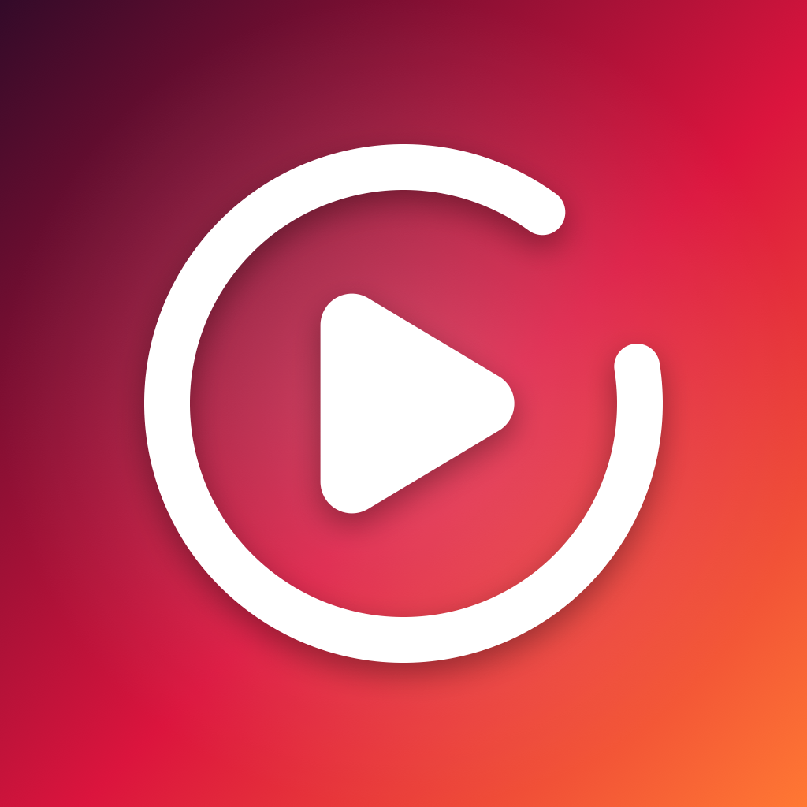

<div align="center">



# Unreel

**YouTube without ads, without Shorts, without sponsor reads — in a native iOS 26 shell.**

  

</div>

Unreel wraps the YouTube mobile website in a native app with a Liquid Glass tab bar, a native
search field, a now-playing accessory and a full settings screen. It is meant to be sideloaded
(for example with [AirRefresh](https://github.com/nikolaus018/airRefresh)); it can't go on the App Store.

## Features

- **Ad blocking that works on YouTube**, in three layers:
  1. **Response cleaning** – `adPlacements`, `playerAds`, `adSlots` and promoted feed items are
     removed from YouTube's API responses and embedded page data *before* the player reads them.
  2. **Filter lists** – uBlock Origin (filters, quick fixes, privacy, unbreak), EasyList,
     EasyPrivacy and optionally Peter Lowe's list. Network rules are compiled into WebKit content
     blockers (≈108k rules); YouTube-specific cosmetic rules and uBlock *scriptlets*
     (`json-prune`, `set-constant`, `trusted-replace-fetch-response`, …) run in the page.
     Lists update automatically (daily by default) or on demand; a snapshot ships with the app so
     blocking works offline on first launch.
  3. **Player fallback** – if an ad still starts, it is muted, fast-forwarded and skipped.
- **No Shorts** – shelves, tabs and search results are removed; Shorts links open in the normal player.
- **SponsorBlock** – skips sponsors, self-promotion and reminders (configurable), with an Undo notice.
- **Playback** – background audio, Picture in Picture, lock screen controls, default speed and
  quality, autoplay toggle, keep-screen-on.
- **Clean-up switches** – end screen cards, Premium promos, merch, Playables, comments, related videos.
- **Native shell** – system tab bar (Home, Subscriptions, You, Settings, Search), native search with
  suggestions, mini-player accessory with play/pause, PiP and Share, pull to refresh, swipe back,
  theme, page size, desktop-site toggle, `unreel://` links.
- Custom filters in uBlock Origin syntax, and stats for ads blocked and time saved.

## Build

```sh
brew install xcodegen      # only needed if you change project.yml
xcodegen generate
open Unreel.xcodeproj
```

Pick your team under *Signing & Capabilities* (the project defaults to the author's team) and run on
a device. There are no app extensions, so a free Apple ID works.

Refresh the bundled filter snapshot with `Scripts/update-bundled-filters.sh`.

## Links

- `unreel://watch?v=VIDEO_ID`
- `unreel://open?url=https://youtu.be/VIDEO_ID`

## How it is put together

| Area | Files |
| --- | --- |
| Filter parsing (uBO/ABP syntax → WebKit rules + page rules) | `Unreel/Blocking/FilterParser.swift` |
| Downloading, caching, compiling | `Unreel/Blocking/FilterListManager.swift`, `ContentBlockerCompiler.swift` |
| In-page engine (cleaning, scriptlets, cosmetics, Shorts, player) | `Unreel/Resources/JS/engine.js` |
| Web view, navigation, media session, SponsorBlock | `Unreel/Web/` |
| SwiftUI shell and settings | `Unreel/UI/`, `Unreel/Settings/` |

Run the tests (`xcodebuild test -scheme Unreel -destination 'platform=iOS Simulator,name=iPhone 17 Pro'`):
they include parsing the real bundled lists and compiling them with WebKit.

## Credits

Filter lists by the uBlock Origin and EasyList authors (GPLv3 / CC BY-SA), SponsorBlock data by
its contributors (CC BY-NC-SA 4.0). Unreel is not affiliated with YouTube or Google.
