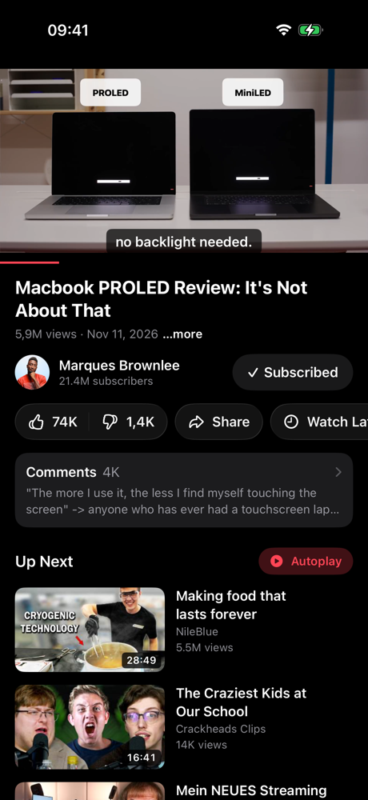
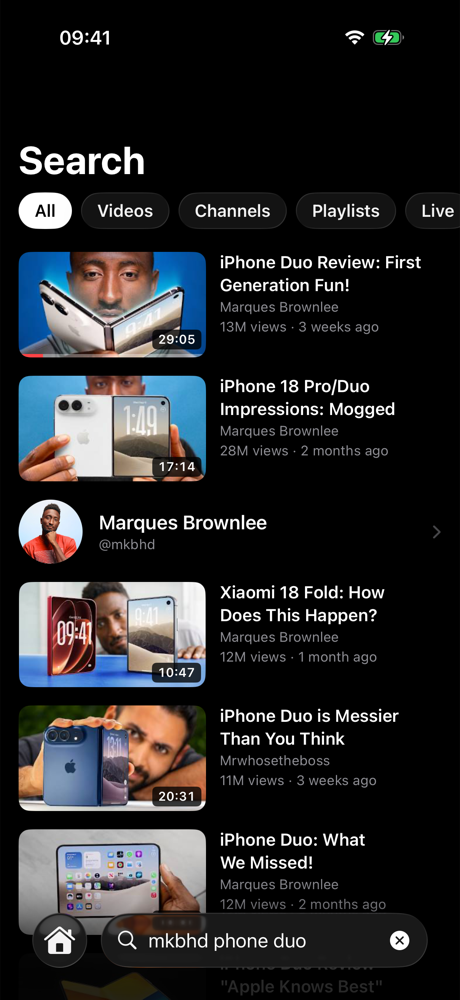
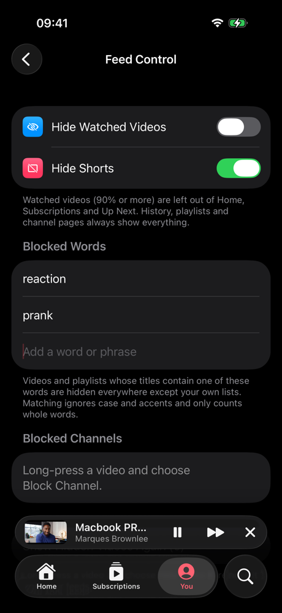
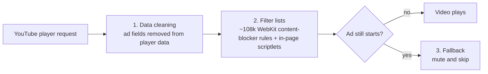

# Unreel

   

Native iOS 26 YouTube client without ads, Shorts or sponsor segments.

   


Every screen in Unreel is SwiftUI: feeds, search, channels, playlists, comments and the player
controls. YouTube's data comes from its internal API (InnerTube), using the same cookies as your
sign-in. Videos play through YouTube's own web player in a hidden view that only shows the
picture, so streams keep working the way they do on youtube.com. Ads are removed from the
player's data before it reads them.

Unreel can't go on the App Store. Sideload it with a free Apple ID, for example with
[AirRefresh](https://github.com/nikolaus018/airRefresh).

## Contents

- [Features](#features)
- [Install](#install)
- [Using the app](#using-the-app)
- [How ad blocking works](#how-ad-blocking-works)
- [Privacy](#privacy)
- [Build from source](#build-from-source)
- [Project layout](#project-layout)
- [Known limitations](#known-limitations)
- [Credits](#credits)

## Features

**Without the noise**
- **No ads.** Video ads, banners and promoted results never appear. See [How ad blocking works](#how-ad-blocking-works).
- **No Shorts** in Home, Subscriptions, search or channel pages. Links to Shorts still open, in the regular player.
- **SponsorBlock** skips sponsor reads, self-promotion and "like and subscribe" reminders (you choose the categories). Segments are marked green on the scrubber, and an Undo notice appears after each skip.
- **Feed Control:** hide watched videos, block channels and words, or hide single videos (long-press ▸ Hide Video / Block Channel). Applies to Home, Subscriptions, search and Up Next, never to your own history or playlists.
- **DeArrow** (optional) swaps clickbait titles and thumbnails for community-written ones.

**No account needed**
- Subscribe to channels on the device: Subscriptions then shows their newest uploads, and Home fills with recommendations based on what you watched and follow.
- Import your subscriptions from a Google Takeout `subscriptions.csv`, and export them again.
- History and resume positions are kept on the device, with watched-progress bars on every thumbnail.

**Player**
- Liquid Glass controls: play/pause, ±10 s, a smoothly moving scrubber that shows what's loaded, chapter marks and the current chapter's name.
- Double-tap the left or right side to seek, then keep tapping to keep seeking (10, 20, 30 s…). Double-tap the middle to play or pause.
- Swipe left or right across the video to scrub, with a large time readout and the chapter you'll land in.
- Press and hold for 2× speed.
- Pinch in full screen to zoom the picture to fill the screen, and pinch back to fit.
- Speed, sleep timer, quality and captions menu. The speed you pick is remembered per channel.
- **Resumes where you left off**, with a Start Over button.
- **Dislike counts** from Return YouTube Dislike next to the thumbs-down.
- Rotation like the YouTube app: turn the phone to go fullscreen and back. The fullscreen button forces landscape while you hold the phone upright, swipe up on the video for fullscreen and swipe down to leave. Swiping down from the top edge in fullscreen still opens Notification Center and Control Center.
- Drag the video (or pull the page below it) down to shrink it into the **mini player** above the tab bar (play/pause, next, close). The mini player keeps showing the video as it plays. Swipe up on it to open it, or left for the next video.
- Lock-screen and headphone Next skips straight to the next video; Previous goes back in a playlist or restarts the video.
- **Autoplay** with an "Up next in 5" card (Cancel / Play Now). In the background or Picture in Picture it moves on right away.
- Background audio, lock-screen and Control Center controls with artwork, Picture in Picture (button, or automatically when you leave the app where iOS allows it). Notification Center and Control Center never interrupt playback.
- Videos that can't play (removed, private, blocked) show YouTube's reason instead of a spinner.

**Native screens**
- **Home:** your recommendations with watched-progress bars, plus Music, Gaming, Podcasts, News and Sports chips.
- **Subscriptions:** a row of your channels and the latest uploads.
- **You:** History, Watch Later, Liked videos, Playlists, Channels, the ads-blocked stats and Settings.
- **Search:** native search field with suggestions and recent searches, plus All / Videos / Channels / Playlists / Live filters. Paste a copied YouTube link to open it.
- **Watch page:** like/dislike, Subscribe, Watch Later, Save to Playlist, Share, PiP; a description sheet with working links, tappable timestamps and a chapter list; comments with reply threads; Up Next.
- **Comments:** like comments, post comments and replies (signed in).
- **Playlists:** Play All and Shuffle. Playing from a playlist builds a queue that Next and autoplay follow. Create, rename and delete your playlists, add any video to them and remove videos.
- **Channels:** banner, stats, Subscribe, block, and Videos / Live / Playlists tabs.
- **Long-press any video:** Play, Play Next, Go to Channel, Save to Watch Later, Save to Playlist, Share, Copy Link, Hide Video, Block Channel.

**Everything else**
- Google sign-in, with personal feeds and account actions.
- `youtube.com`, `youtu.be` and `unreel://` links open in the app, including `?t=` timestamps.
- Dark and light mode, haptics, and a settings screen for all of the above (**You ▸ Settings**).
- Built to Apple's Human Interface Guidelines: VoiceOver, Dynamic Type, Reduce Motion, 44 pt touch targets, hardware keyboard shortcuts in the player, and an iPad sidebar.

## Install

1. Download `Unreel-1.3.0.ipa` from the [latest release](../../releases/latest).
2. Sign and install it with your sideloading tool (AirRefresh, Sideloadly, AltStore, …).
   There are no app extensions, so one free-account app ID is enough.
3. Open Unreel, then sign in from **You ▸ Sign In with Google** if you want your feeds.

Requires iOS 26.1 or later.

## Using the app

| Gesture | Where | Does |
| --- | --- | --- |
| Tap | Video | Show / hide controls |
| Double-tap left / right | Video | Seek −10 / +10 s; keep tapping to keep seeking |
| Double-tap the middle | Video | Play / pause |
| Swipe left / right | Video | Scrub, with a time preview |
| Press and hold | Video | Play at 2× while held |
| Pinch | Video (full screen) | Zoom to fill / fit |
| Swipe down | Video or page below it (portrait) | Shrink into the mini player |
| Swipe up | Video (portrait) | Full screen |
| Swipe down | Video (full screen) | Leave full screen. From the top edge it opens Notification Center / Control Center as usual |
| Swipe up / left | Mini player | Open the player / next video |
| Turn the phone | Player open | Enter / leave full screen |
| Drag the scrubber | Controls | Seek, with a tick at each chapter |
| Long-press | Any video | Play Next, Save to Playlist, Hide, Block Channel… |
| Long-press | Mini player | Open, PiP, Close |
| Space / ← → / F | Player (hardware keyboard) | Play-pause / seek 10 s / full screen |

Links: `unreel://watch?v=VIDEO_ID&t=90` or `unreel://open?url=https://youtu.be/VIDEO_ID`.

## How ad blocking works



1. **Data cleaning.** A script runs in the player page before YouTube's code does. It removes
   `adPlacements`, `playerAds`, `adSlots` and promoted items from the player's data, both from
   API responses (`fetch`/XHR) and from the data embedded in the page. If there's nothing to
   schedule, the player plays no ads.
2. **Filter lists.** uBlock Origin (filters, quick fixes, privacy, unbreak), EasyList and
   EasyPrivacy are parsed on the device. Rules that can't apply on YouTube are left out, and
   about 108k network rules are compiled into WebKit content blockers. YouTube-specific uBlock
   *scriptlets* (`json-prune`, `set-constant`, `trusted-replace-fetch-response`, …) and
   `replace=` rules run in the page. Lists update automatically (daily by default) or from
   You ▸ Settings, and a snapshot ships with the app so blocking works on first launch.
3. **Fallback.** If an ad still starts, it is muted and skipped.

Because every list, browse and search screen is drawn natively, promoted cards are never shown
anyway.

## Privacy

- No analytics or tracking in the app. Network traffic goes to YouTube/Google, the filter-list
  hosts (`ublockorigin.github.io`), SponsorBlock and DeArrow (`sponsor.ajay.app`, which only
  receive the first characters of a hash of the video ID), DeArrow thumbnails
  (`dearrow-thumb.ajay.app`, only when that option is on) and Return YouTube Dislike
  (`returnyoutubedislikeapi.com`, which receives the ID of the video you open; turn off
  **Show Dislikes** to stop that).
- History, resume positions, local subscriptions, blocked channels and words are stored only on
  the device (Application Support). **You ▸ History ▸ Clear** removes the history.
- Your Google sign-in lives in the app's web storage on the device. **You ▸ Sign Out** deletes it.
- Debug builds save the last API response per endpoint in the app's Caches folder for
  troubleshooting. Release builds don't.

## Build from source

```sh
brew install xcodegen   # only needed if you change project.yml
xcodegen generate
open Unreel.xcodeproj
```

Pick your team under *Signing & Capabilities* (the project defaults to the author's team).

Unsigned `.ipa`, the way release builds are made:

```sh
xcodebuild -project Unreel.xcodeproj -scheme Unreel -configuration Release -sdk iphoneos \
  -derivedDataPath build/release CODE_SIGNING_ALLOWED=NO build
mkdir -p dist/Payload && cp -R build/release/Build/Products/Release-iphoneos/Unreel.app dist/Payload/
(cd dist && zip -qry Unreel.ipa Payload && rm -rf Payload)
```

Tests (filter parsing plus a WebKit compile of the real lists, InnerTube parsing from captured
responses, timestamps):

```sh
xcodebuild test -project Unreel.xcodeproj -scheme Unreel -destination 'platform=iOS Simulator,name=iPhone 17 Pro'
```

Refresh the bundled filter snapshot with `Scripts/update-bundled-filters.sh`.

## Project layout

| Area | Files |
| --- | --- |
| App state, navigation, queue, rotation | `Unreel/App/` |
| InnerTube client, models, parser, paged feeds, on-device library and feeds, RYD/DeArrow | `Unreel/Data/` |
| Player bridge, Now Playing, SponsorBlock | `Unreel/Player/` |
| Filter lists: parsing, downloading, compiling | `Unreel/Blocking/` |
| In-page engine: ad cleaning, scriptlets, player-only mode | `Unreel/Resources/JS/engine.js` |
| SwiftUI screens and settings | `Unreel/UI/`, `Unreel/Settings/` |

## Known limitations

- Comment actions, posting and playlist editing use the same API as YouTube's site and only
  work signed in; YouTube may refuse them for some videos (comments off, kids content).
- Without an account, Home is built from the channels you follow and the videos you watched, so
  it starts empty until you do either.
- Unreel depends on YouTube's internal API and web player. When YouTube changes them, parts of
  the app can break until they're updated. Ad-blocking fixes usually arrive through the filter
  lists without an app update.
- Picture in Picture and background audio can't be tested in the simulator; they target real devices.

## Credits

Filter lists by the uBlock Origin and EasyList authors (GPLv3 / CC BY-SA 3.0), skip segments by
the SponsorBlock community (CC BY-NC-SA 4.0). Unreel is not affiliated with YouTube or Google.
